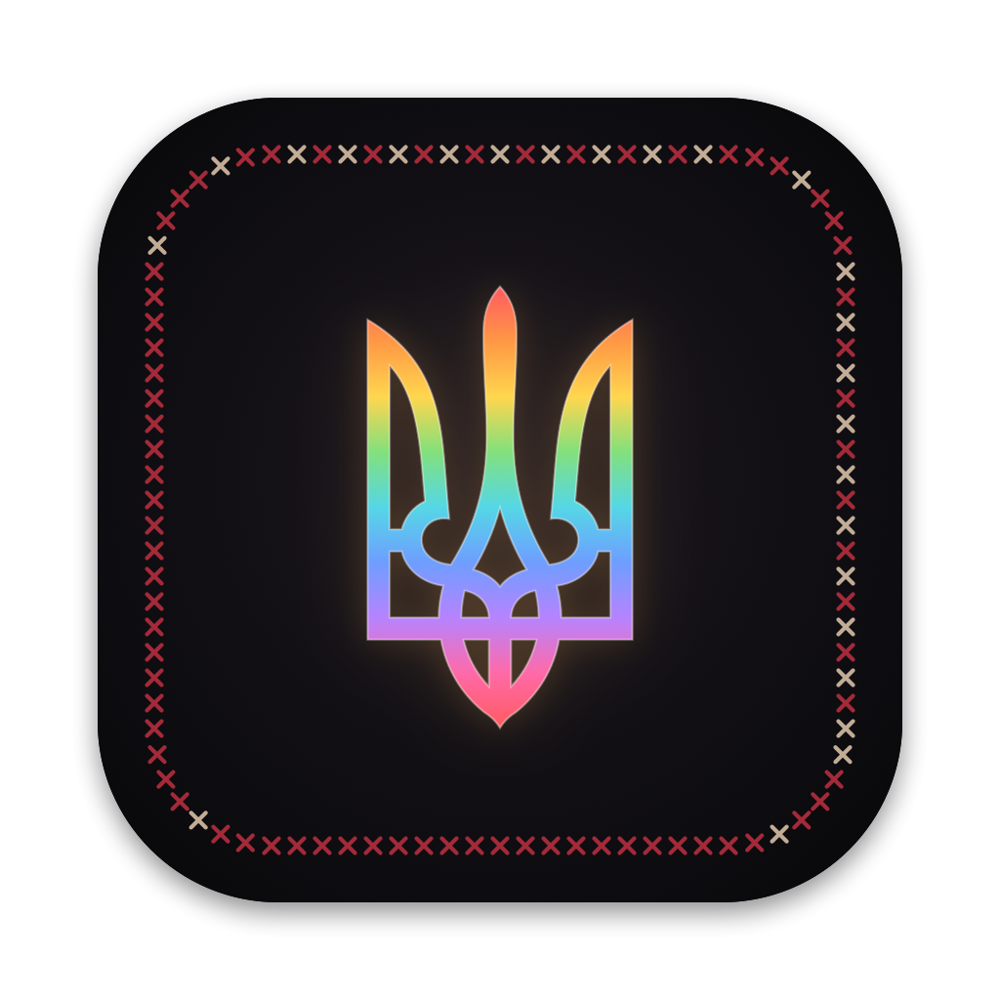
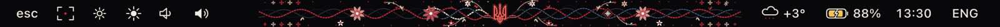
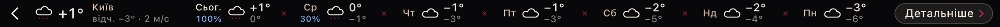
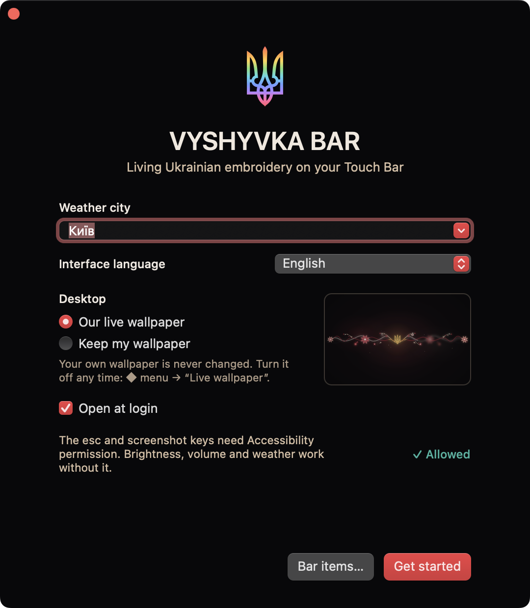
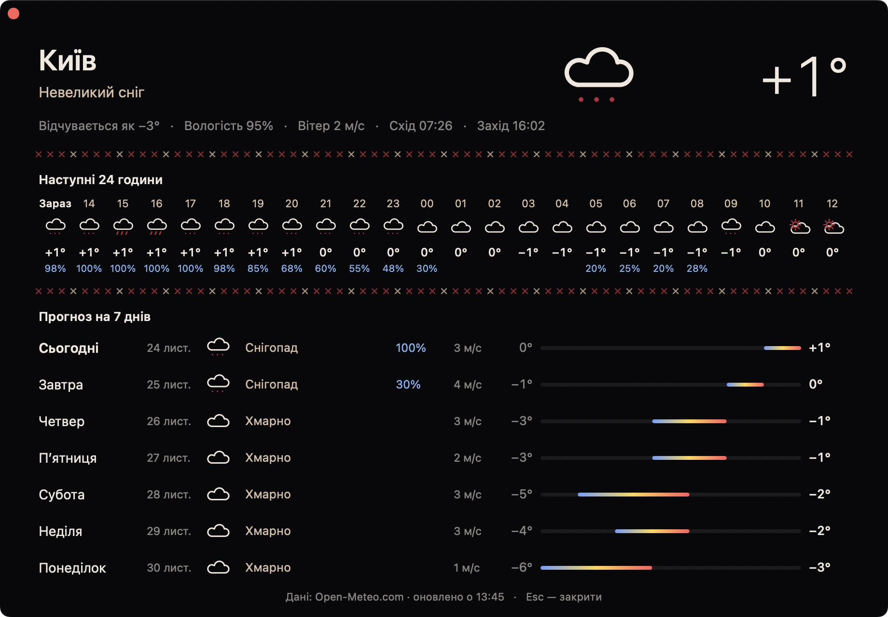
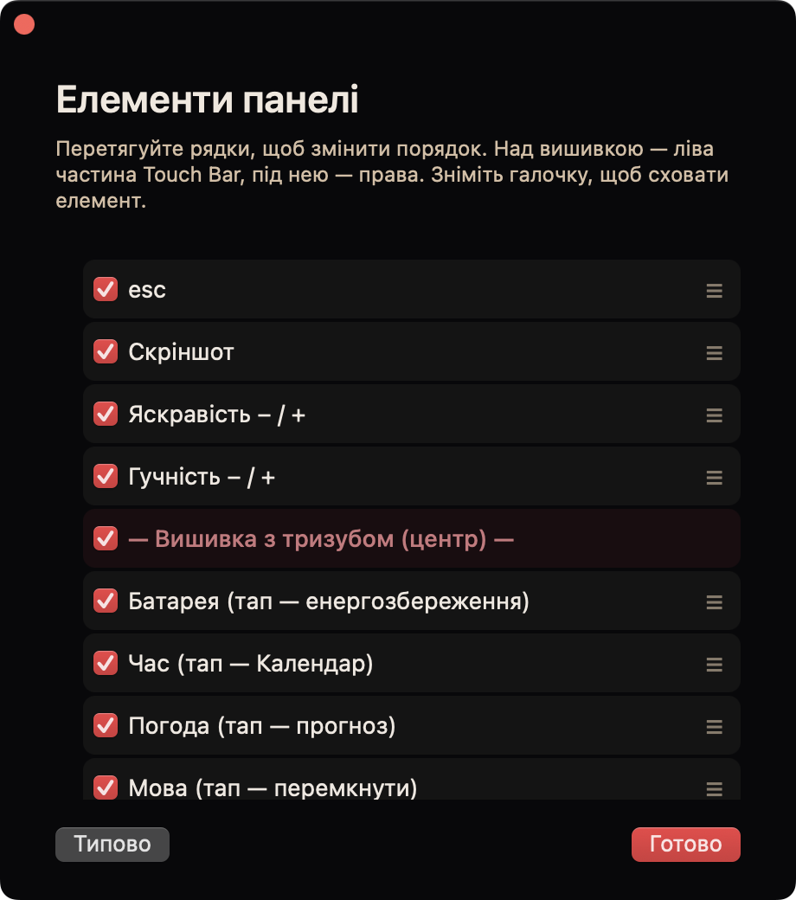
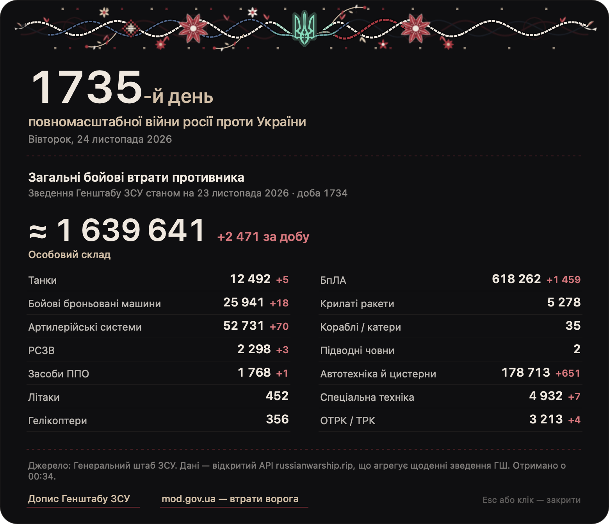
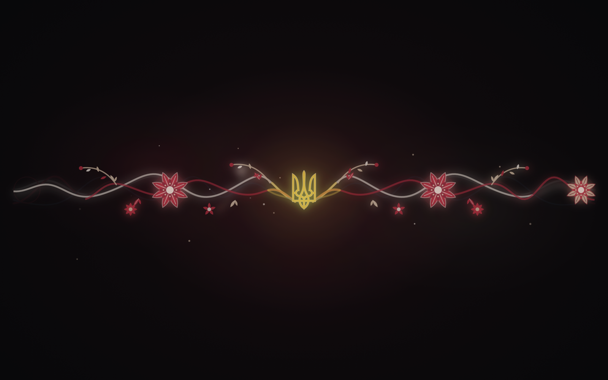

<p align="center">
  
</p>

<h1 align="center">VYSHYVKA BAR</h1>
<p align="center"><b>Living Ukrainian embroidery for your MacBook Pro Touch Bar</b></p>

<p align="center">
  <b>English</b> · <a href="README.uk.md">Українська</a> · <a href="README.ru.md">Русский</a>
</p>

<p align="center">
  <a href="https://github.com/sapio-sat/vyshyvka-bar/releases/latest/download/VYSHYVKA-BAR.dmg"></a>
  
  
  
</p>

<p align="center"></p>

VYSHYVKA BAR replaces the standard Touch Bar with one continuous, slowly breathing piece of Ukrainian embroidery — threads, roses, cross-stitch and a rainbow trident in the centre — with the controls you actually use built right into it. Free, open source, no subscriptions, no tracking.

## Features

| | |
|---|---|
| **Living embroidery** | Hand-crafted vector embroidery animated at 24 fps; pauses when the screen sleeps and respects *Reduce Motion*. |
| **Useful controls** | esc, screenshot, brightness −/+, volume −/+ with an on-screen level indicator. |
| **Weather** | Any city in the world. Tap it for a 7-day forecast right on the Touch Bar; **Details** opens a full window with 24 hours and 7 days. |
| **Battery** | White in normal mode, yellow in Low Power Mode. Tap to toggle Low Power Mode. |
| **Time** | Tap to open Calendar. |
| **Language** | Shows the current input source; tap to switch. |
| **Trident** | Tap the trident for the daily report of the General Staff of Ukraine and the day of the full-scale war. |
| **Live wallpaper** | Optional, matching animated desktop wallpaper — a pre-rendered seamless loop, light on the GPU. Your own wallpaper is never changed. |
| **Your layout** | Reorder or hide any item, even the embroidery itself. |
| **Three languages** | Українська · Русский · English, follows the system or chosen in Settings. |

<p align="center"></p>

<table>
<tr>
<td></td>
<td></td>
</tr>
<tr>
<td></td>
<td></td>
</tr>
</table>

<p align="center"></p>

## Install

1. **[Download VYSHYVKA-BAR.dmg](https://github.com/sapio-sat/vyshyvka-bar/releases/latest/download/VYSHYVKA-BAR.dmg)** and open it.
2. Drag **VYSHYVKA BAR** to **Applications**.
3. Open it. macOS may say it *cannot verify the developer* — the app is free and not signed with a paid Apple certificate. Click **Done**, then open **System Settings → Privacy & Security**, scroll down and click **Open Anyway**. You only do this once.
   *On macOS 12–14 you can also right-click the app → Open.*
4. In the welcome window choose your city, wallpaper and launch at login. Done.

> **esc and screenshot** need *Accessibility* permission — the welcome window has an **Allow…** button. Brightness, volume and weather work without it.

### Supported Macs
Every MacBook Pro with a Touch Bar, 2016–2022, Intel and Apple Silicon, macOS 12 Monterey or later. On models with a physical Esc key (16″ 2019, 13″ 2020, M1, M2) the layout adapts to the shorter Touch Bar automatically.

## Menu & settings
The **◆** icon in the menu bar gives you: show the panel, the General Staff report, weekly weather, live wallpaper on/off, weather city, **Bar items…**, Low Power Mode without password, **Settings…** and **Quit — restore the standard Touch Bar**.

## Uninstall
Choose **◆ → Quit**, then drag the app from Applications to the Trash. If you enabled *Low Power Mode without password*, turn it off in the ◆ menu first.

## Privacy & safety
- No accounts, analytics or tracking. Network requests go only to Open-Meteo (weather, geocoding) and russianwarship.rip (General Staff data).
- SIP and Gatekeeper stay on. No kernel extensions.
- *Low Power Mode without password* is opt-in: it adds a narrow sudoers rule that lets **only your user** run **only** `pmset -a lowpowermode 0|1`, validated with `visudo` before installing.

## Build from source
Only the Command Line Tools are needed (`xcode-select --install`):
```bash
git clone https://github.com/sapio-sat/vyshyvka-bar.git
cd vyshyvka-bar
./build.sh --dmg
```
The app uses private Touch Bar APIs (the same approach as MTMR and BetterTouchTool), which is why it can't be on the Mac App Store.

## FAQ
**Why isn't it on the App Store?** Apple doesn't allow apps that replace the whole Touch Bar or use private APIs.  
**Does it drain the battery?** The embroidery runs at 24 fps and stops when the display sleeps; the wallpaper is a hardware-decoded video loop.  
**How do I get the standard Touch Bar back?** ◆ → Quit.

## Credits
Made by **Nikola Frank** in Ukraine. Trident outline from the public-domain *Coat of Arms of Ukraine* (Wikimedia Commons). Weather by [Open-Meteo](https://open-meteo.com) (CC BY 4.0). Losses data: General Staff of the Armed Forces of Ukraine via [russianwarship.rip](https://russianwarship.rip).

Released under the [MIT License](LICENSE).
