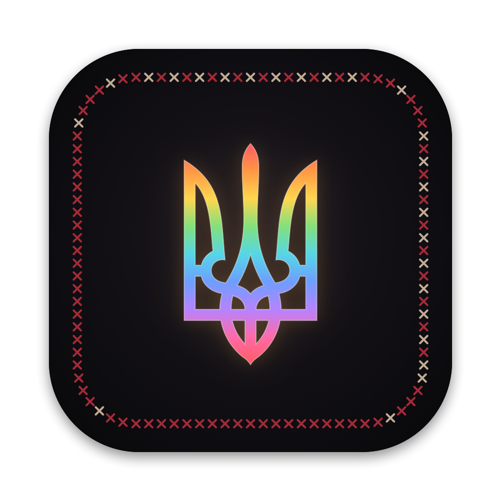
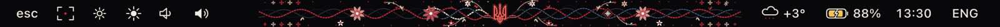
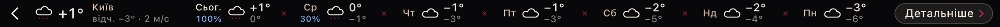
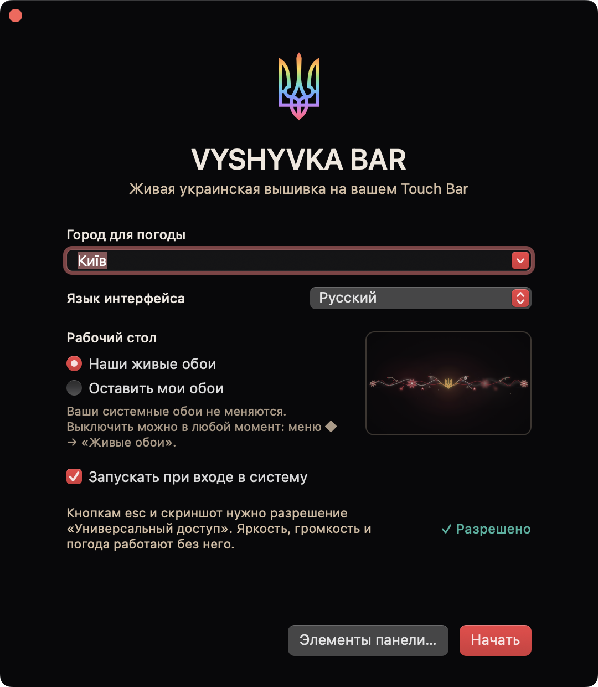
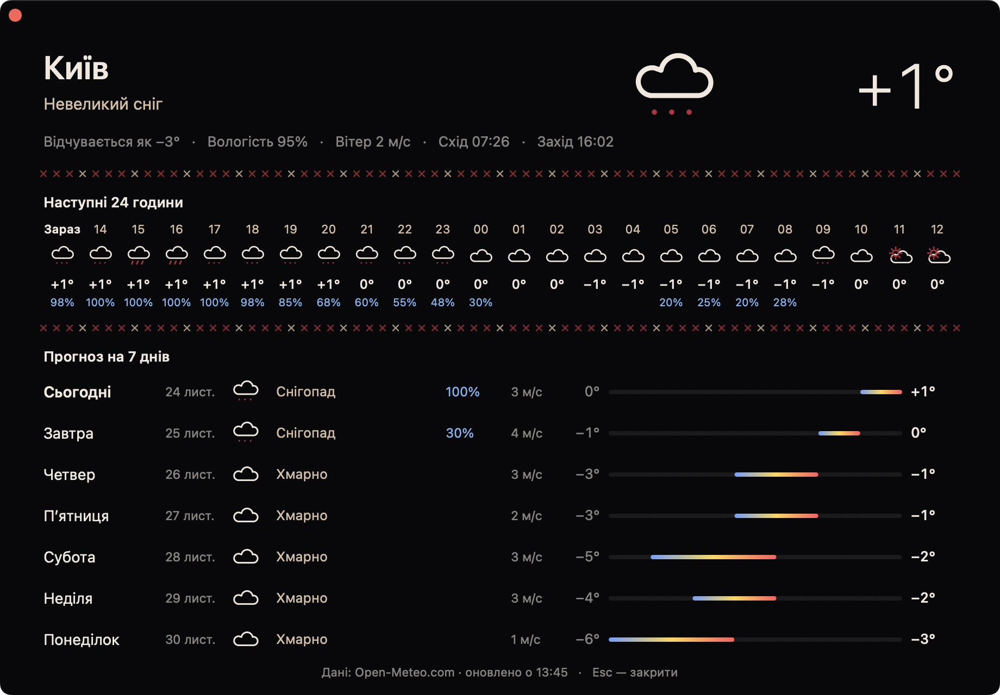
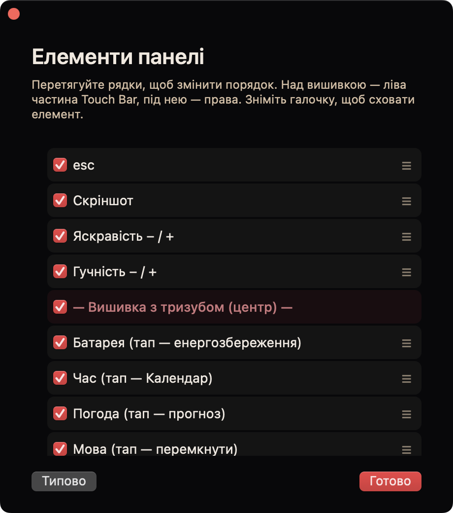
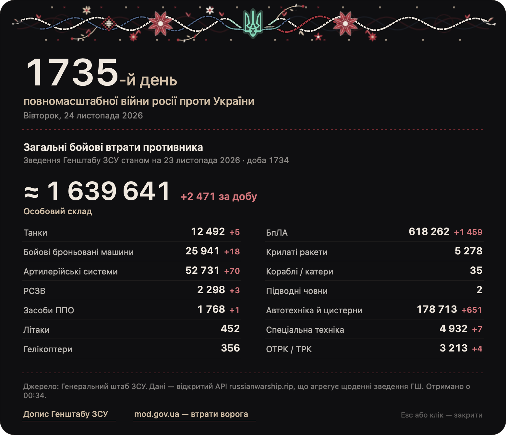
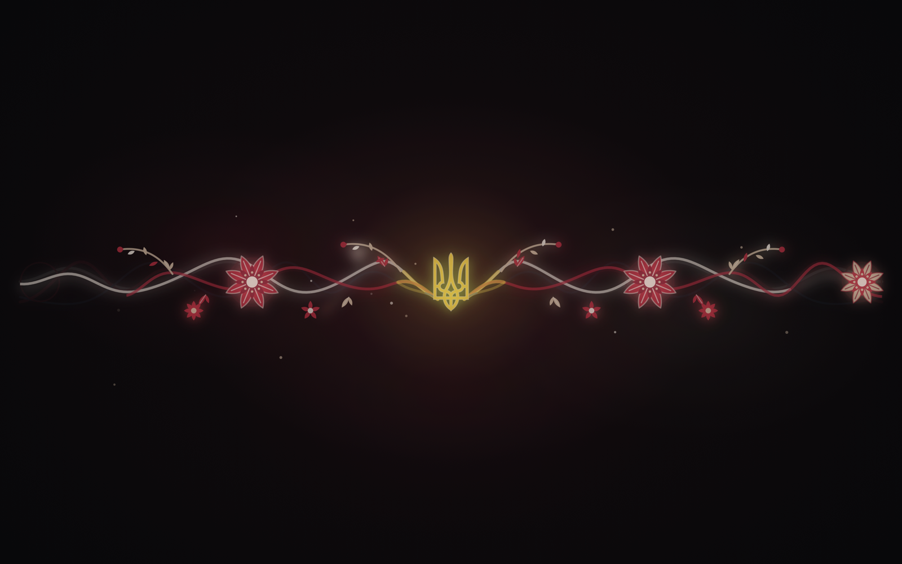

<p align="center">
  
</p>

<h1 align="center">VYSHYVKA BAR</h1>
<p align="center"><b>Живая украинская вышивка на Touch Bar вашего MacBook Pro</b></p>

<p align="center">
  <a href="README.md">English</a> · <a href="README.uk.md">Українська</a> · <b>Русский</b>
</p>

<p align="center">
  <a href="https://github.com/sapio-sat/vyshyvka-bar/releases/latest/download/VYSHYVKA-BAR.dmg"></a>
  
  
  
</p>

<p align="center"></p>

VYSHYVKA BAR заменяет стандартный Touch Bar одной сплошной, медленно «дышащей» украинской вышивкой: нити, розы, крестик и радужный тризуб в центре. Нужные кнопки встроены прямо в узор. Бесплатно, открытый код, без подписок и слежки.

## Возможности

| | |
|---|---|
| **Живая вышивка** | Векторная вышивка с анимацией 24 кадра/с; останавливается, когда экран засыпает, и учитывает «Уменьшить движение». |
| **Полезные кнопки** | esc, скриншот, яркость −/+, громкость −/+ с индикатором уровня на экране. |
| **Погода** | Любой город мира. Тап — прогноз на 7 дней прямо на Touch Bar; **Подробнее** открывает окно с 24 часами и 7 днями. |
| **Батарея** | Белая в обычном режиме, жёлтая в режиме энергосбережения. Тап — включить/выключить энергосбережение. |
| **Время** | Тап открывает Календарь. |
| **Язык** | Показывает текущую раскладку; тап — переключить. |
| **Тризуб** | Тап — ежедневная сводка Генштаба ВСУ и день полномасштабной войны. |
| **Живые обои** | По желанию — анимированные обои в том же стиле; заранее отрендеренный бесшовный ролик, почти не нагружает систему. Ваши обои не меняются. |
| **Свой порядок** | Любой элемент можно переставить или скрыть, даже саму вышивку. |
| **Три языка** | Українська · Русский · English — по языку системы или вручную в настройках. |

<p align="center"></p>

<table>
<tr>
<td></td>
<td></td>
</tr>
<tr>
<td></td>
<td></td>
</tr>
</table>

<p align="center"></p>

## Установка

1. **[Скачайте VYSHYVKA-BAR.dmg](https://github.com/sapio-sat/vyshyvka-bar/releases/latest/download/VYSHYVKA-BAR.dmg)** и откройте его.
2. Перетащите **VYSHYVKA BAR** в папку **Applications** («Программы»).
3. Откройте приложение. macOS может написать, что *не удалось проверить разработчика*: приложение бесплатное и не подписано платным сертификатом Apple. Нажмите **Готово**, откройте **Системные настройки → Конфиденциальность и безопасность**, прокрутите вниз и нажмите **Всё равно открыть**. Это нужно сделать один раз.
   *На macOS 12–14 можно также: правый клик по приложению → Открыть.*
4. В окне приветствия выберите город, обои и автозапуск. Готово.

> **esc и скриншоту** нужно разрешение *Универсальный доступ* — в окне приветствия есть кнопка **Разрешить…**. Яркость, громкость и погода работают без него.

### Какие Mac поддерживаются
Все MacBook Pro с Touch Bar 2016–2022 годов, Intel и Apple Silicon, macOS 12 Monterey и новее. На моделях с физической клавишей Esc (16″ 2019, 13″ 2020, M1, M2) панель сама подстраивается под более короткий Touch Bar.

## Меню и настройки
Значок **◆** в строке меню: показать панель, сводка Генштаба, погода на неделю, живые обои, город погоды, **Элементы панели…**, энергосбережение без пароля, **Настройки…** и **Выйти — вернуть стандартный Touch Bar**.

## Удаление
**◆ → Выйти**, затем перетащите приложение из Applications в Корзину. Если включали *энергосбережение без пароля*, сначала выключите его в меню ◆.

## Приватность и безопасность
- Без аккаунтов, аналитики и слежки. Сетевые запросы — только к Open-Meteo (погода, поиск города) и russianwarship.rip (данные Генштаба).
- SIP и Gatekeeper остаются включёнными. Никаких расширений ядра.
- *Энергосбережение без пароля* — только с вашего согласия: добавляется узкое правило sudoers, которое разрешает **только вашему пользователю** выполнять **только** `pmset -a lowpowermode 0|1`; правило проверяется `visudo` перед установкой.

## Сборка из исходников
Нужны только Command Line Tools (`xcode-select --install`):
```bash
git clone https://github.com/sapio-sat/vyshyvka-bar.git
cd vyshyvka-bar
./build.sh --dmg
```
Приложение использует приватные API Touch Bar (так же, как MTMR и BetterTouchTool), поэтому его не может быть в Mac App Store.

## Вопросы
**Почему не в App Store?** Apple не пропускает приложения, которые заменяют весь Touch Bar или используют приватные API.  
**Сажает ли батарею?** Вышивка работает на 24 кадрах/с и останавливается, когда экран засыпает; обои — аппаратно декодируемый видеоролик.  
**Как вернуть стандартный Touch Bar?** ◆ → Выйти.

## Автор и благодарности
Создал **Nikola Frank** в Украине. Контур тризуба — из *Coat of Arms of Ukraine* (Wikimedia Commons, общественное достояние). Погода — [Open-Meteo](https://open-meteo.com) (CC BY 4.0). Данные о потерях — Генеральный штаб ВСУ через [russianwarship.rip](https://russianwarship.rip).

Лицензия [MIT](LICENSE).
