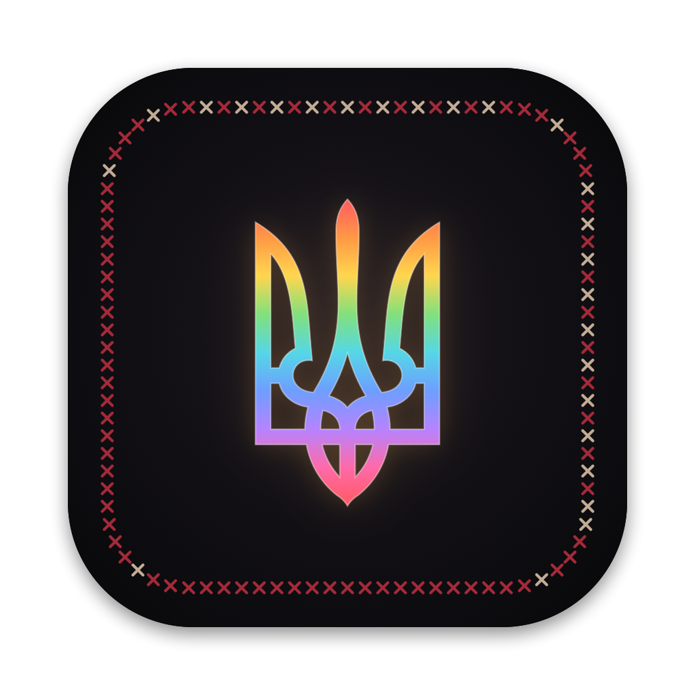
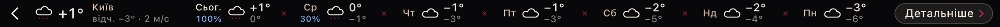
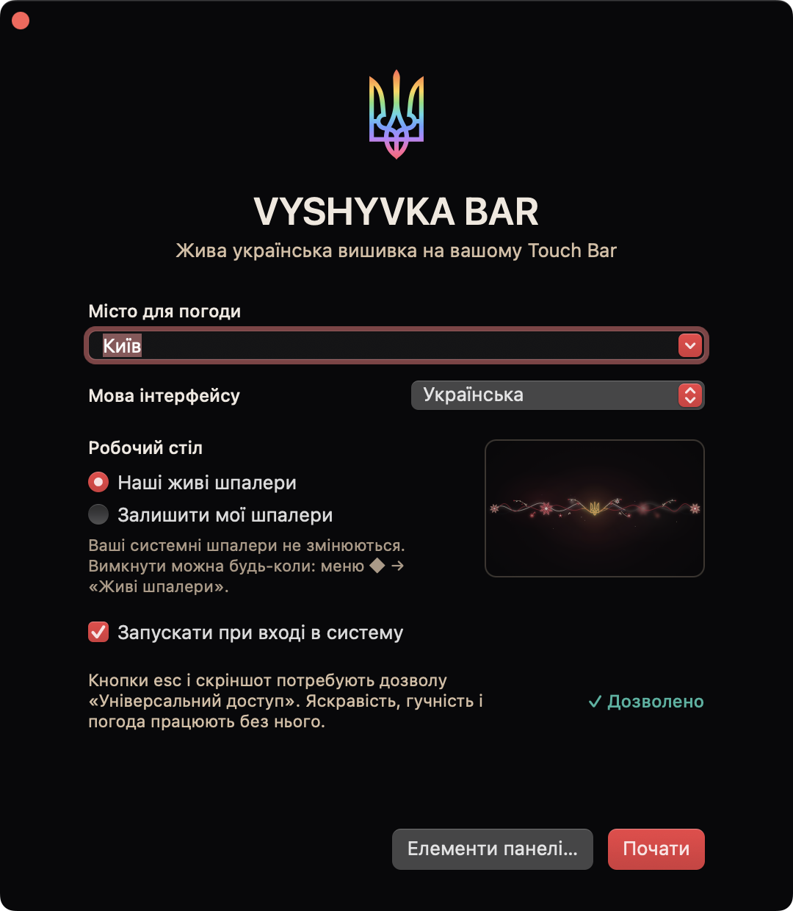
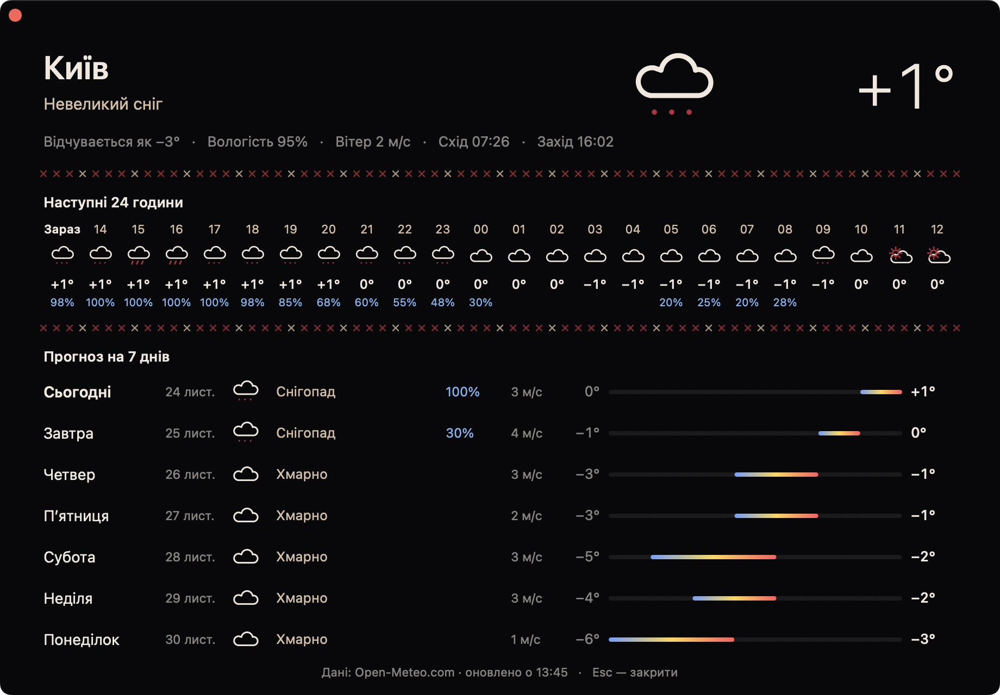
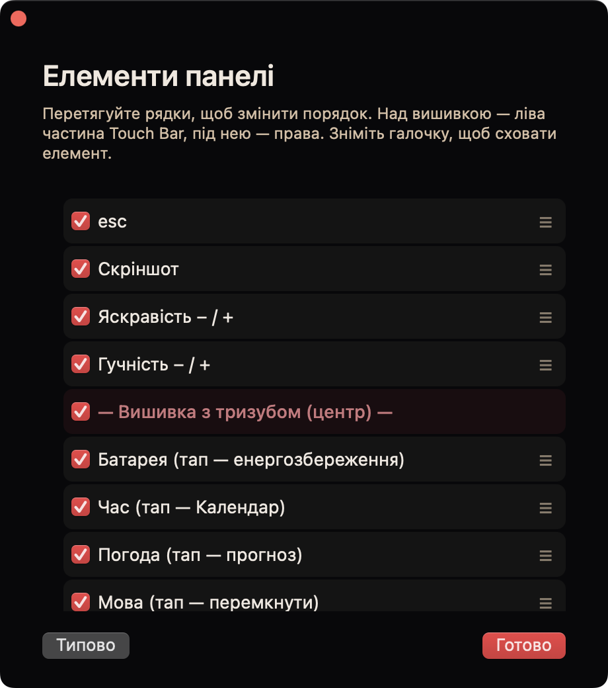
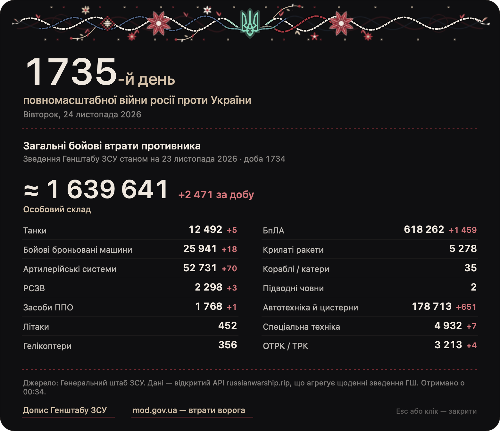
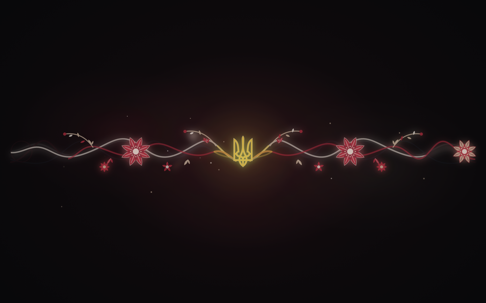

<p align="center">
  
</p>

<h1 align="center">VYSHYVKA BAR</h1>
<p align="center"><b>Жива українська вишивка на Touch Bar вашого MacBook Pro</b></p>

<p align="center">
  <a href="README.md">English</a> · <b>Українська</b> · <a href="README.ru.md">Русский</a>
</p>

<p align="center">
  <a href="https://github.com/sapio-sat/vyshyvka-bar/releases/latest/download/VYSHYVKA-BAR.dmg"></a>
  
  
  
</p>

<p align="center"></p>

VYSHYVKA BAR замінює стандартний Touch Bar однією суцільною вишивкою, що повільно «дихає»: нитки, рози, хрестик і веселковий тризуб у центрі. Потрібні кнопки вбудовані просто у візерунок. Безкоштовно, відкритий код, без підписок і стеження.

## Можливості

| | |
|---|---|
| **Жива вишивка** | Векторна вишивка з анімацією 24 кадри/с; зупиняється, коли екран засинає, і поважає «Зменшити рух». |
| **Корисні кнопки** | esc, скріншот, яскравість −/+, гучність −/+ з індикатором рівня на екрані. |
| **Погода** | Будь-яке місто світу. Тап — прогноз на 7 днів просто на Touch Bar; **Детальніше** відкриває вікно з 24 годинами й 7 днями. |
| **Батарея** | Біла у звичайному режимі, жовта в режимі енергозбереження. Тап — увімкнути/вимкнути енергозбереження. |
| **Час** | Тап відкриває Календар. |
| **Мова** | Показує поточну розкладку; тап — перемкнути. |
| **Тризуб** | Тап — щоденне зведення Генштабу ЗСУ і день повномасштабної війни. |
| **Живі шпалери** | За бажанням — анімовані шпалери в тому ж стилі; заздалегідь зрендерений безшовний ролик, майже не навантажує систему. Ваші шпалери не змінюються. |
| **Свій порядок** | Будь-який елемент можна переставити або сховати, навіть саму вишивку. |
| **Три мови** | Українська · Русский · English — за мовою системи або вручну в налаштуваннях. |

<p align="center"></p>

<table>
<tr>
<td></td>
<td></td>
</tr>
<tr>
<td></td>
<td></td>
</tr>
</table>

<p align="center"></p>

## Встановлення

1. **[Завантажте VYSHYVKA-BAR.dmg](https://github.com/sapio-sat/vyshyvka-bar/releases/latest/download/VYSHYVKA-BAR.dmg)** і відкрийте його.
2. Перетягніть **VYSHYVKA BAR** у папку **Applications**.
3. Відкрийте програму. macOS може написати, що *не вдалося перевірити розробника*: програма безкоштовна й не підписана платним сертифікатом Apple. Натисніть **Готово**, відкрийте **Системні параметри → Конфіденційність і безпека**, прокрутіть донизу й натисніть **Усе одно відкрити**. Це потрібно лише один раз.
   *На macOS 12–14 можна також: правий клік по програмі → Відкрити.*
4. У вікні привітання оберіть місто, шпалери й автозапуск. Готово.

> **esc і скріншот** потребують дозволу *Універсальний доступ* — у вікні привітання є кнопка **Дозволити…**. Яскравість, гучність і погода працюють без нього.

### Які Mac підтримуються
Усі MacBook Pro з Touch Bar 2016–2022 років, Intel і Apple Silicon, macOS 12 Monterey і новіші. На моделях із фізичною клавішею Esc (16″ 2019, 13″ 2020, M1, M2) панель сама підлаштовується під коротший Touch Bar.

## Меню й налаштування
Значок **◆** у рядку меню: показати панель, зведення Генштабу, погода на тиждень, живі шпалери, місто погоди, **Елементи панелі…**, енергозбереження без пароля, **Налаштування…** і **Вийти — повернути стандартний Touch Bar**.

## Видалення
**◆ → Вийти**, потім перетягніть програму з Applications у кошик. Якщо вмикали *енергозбереження без пароля*, спершу вимкніть його в меню ◆.

## Приватність і безпека
- Без акаунтів, аналітики й стеження. Мережеві запити — лише до Open-Meteo (погода, пошук міста) і russianwarship.rip (дані Генштабу).
- SIP і Gatekeeper залишаються ввімкненими. Жодних розширень ядра.
- *Енергозбереження без пароля* — лише за вашою згодою: додається вузьке правило sudoers, яке дозволяє **лише вашому користувачу** виконувати **лише** `pmset -a lowpowermode 0|1`; правило перевіряється `visudo` перед встановленням.

## Збірка з вихідного коду
Потрібні лише Command Line Tools (`xcode-select --install`):
```bash
git clone https://github.com/sapio-sat/vyshyvka-bar.git
cd vyshyvka-bar
./build.sh --dmg
```
Програма використовує приватні API Touch Bar (так само, як MTMR і BetterTouchTool), тому її не може бути в Mac App Store.

## Питання
**Чому не в App Store?** Apple не допускає програми, що замінюють увесь Touch Bar або використовують приватні API.  
**Чи садить батарею?** Вишивка працює на 24 кадри/с і зупиняється, коли екран засинає; шпалери — апаратно декодований відеоролик.  
**Як повернути стандартний Touch Bar?** ◆ → Вийти.

## Автор і подяки
Створив **Nikola Frank** в Україні. Контур тризуба — з *Coat of Arms of Ukraine* (Wikimedia Commons, суспільне надбання). Погода — [Open-Meteo](https://open-meteo.com) (CC BY 4.0). Дані про втрати — Генеральний штаб ЗСУ через [russianwarship.rip](https://russianwarship.rip).

Ліцензія [MIT](LICENSE).
